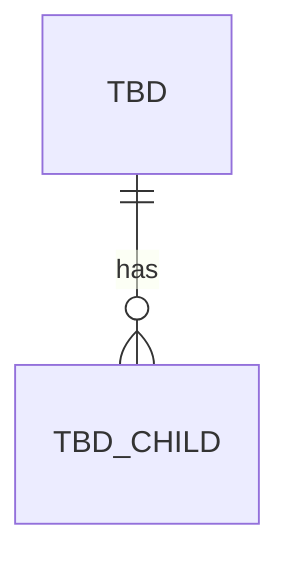

# Database Schema and ERD

## Entities

[To be determined. Each entity, what it represents, and the requirements that need it.]

## Schema

[TBD — one table per entity:]

| Table | Column | Type | Constraints | Notes |
|-------|--------|------|-------------|-------|
| [TBD] | | | | |

## Entity relationship diagram

## Migrations

[TBD — how the schema is created and evolved.]

## Retention

[TBD — what is kept, for how long, and how it is deleted.]
