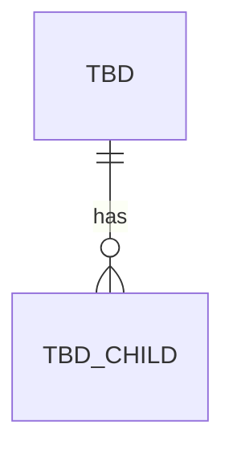

# Domain model and data rules

The core entities the whole application shares, and the rules all data follows. Feature
specific tables and fields are not listed here: each feature's plan adds them
(`compose-plan`) following these rules.

## Core entities

[To be determined. The few entities most features touch, what each represents, and which
component owns it.]

## Entity relationship diagram

## Data rules

[TBD — storage choices per kind of data, naming, identifiers, timestamps and time zones,
soft or hard delete, personal data handling, auditing.]

## Migrations

[TBD — how the schema is created and evolved, and the rules a migration must follow.]

## Retention

[TBD — what is kept, for how long, and how it is deleted.]
