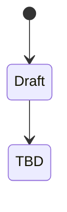

# UI/UX and State Flows

## Screens

[To be determined. Each screen or surface, its purpose, and what the user sees and does there.]

## User journeys

[TBD — the main journeys, step by step, from entry to outcome, including error paths.]

## State flows

[TBD — the states of the key entities or screens and the transitions between them:]

