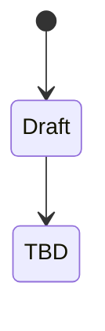

# UX standards

The interaction rules every screen and surface follows. It describes no individual screens or
journeys: those belong to each feature's specification and plan.

## Surfaces and navigation

[To be determined. The kinds of surfaces the application has (web, mobile, CLI, email…) and
how users move between areas.]

## Interaction patterns

[TBD — the patterns features reuse: forms and validation, confirmation of destructive
actions, empty, loading and error states, notifications, undo.]

## Accessibility and localization

[TBD — the accessibility level to meet (for example WCAG 2.2 AA), supported languages,
date, number and currency formats.]

## Design system

[TBD — the component library, visual tokens and content style (tone, terminology) to use.]

## State conventions

[TBD — how the states of user-facing entities are named, shown and changed, for example:]

