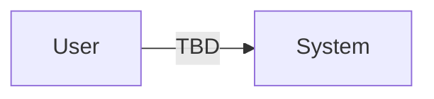

# System Architecture

## Context

[To be determined. The system's boundary: users, external systems and the main interactions.]

## Components

[TBD — each component, its responsibility, and the technology chosen (with ADR links).]

## Data flows

[TBD — how data moves between components, including trust boundaries.]

## Deployment

[TBD — environments, hosting, scaling and topology.]

## Cross-cutting concerns

[TBD — security, observability, error handling, performance, configuration.]

## Threat model

[TBD — the main threats and their mitigations, with a diagram:]

